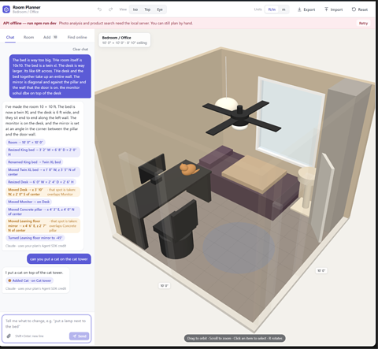
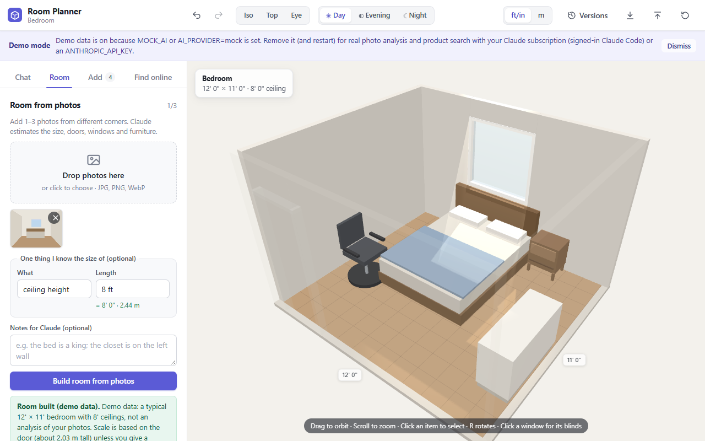
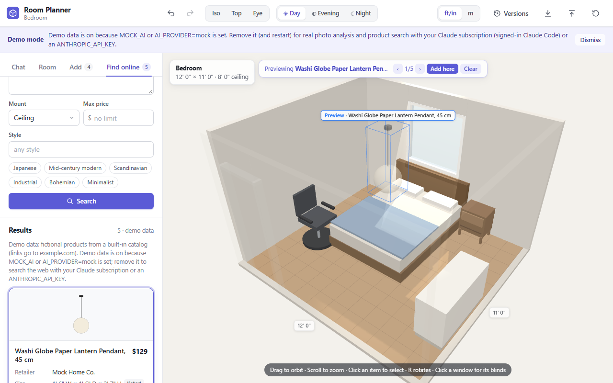
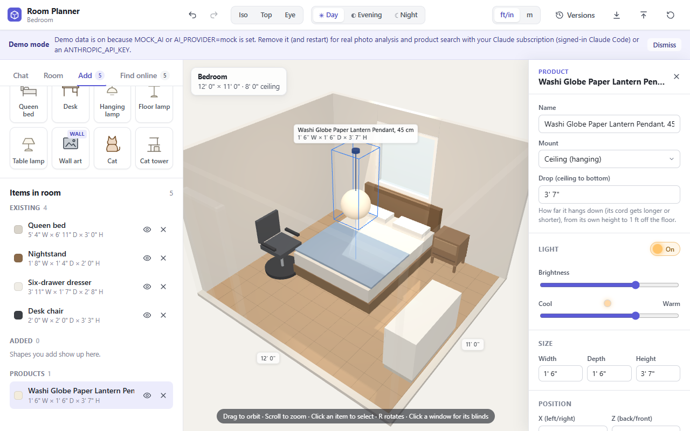
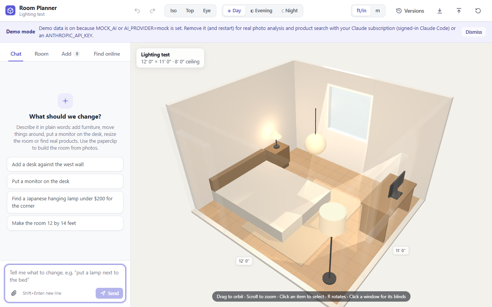
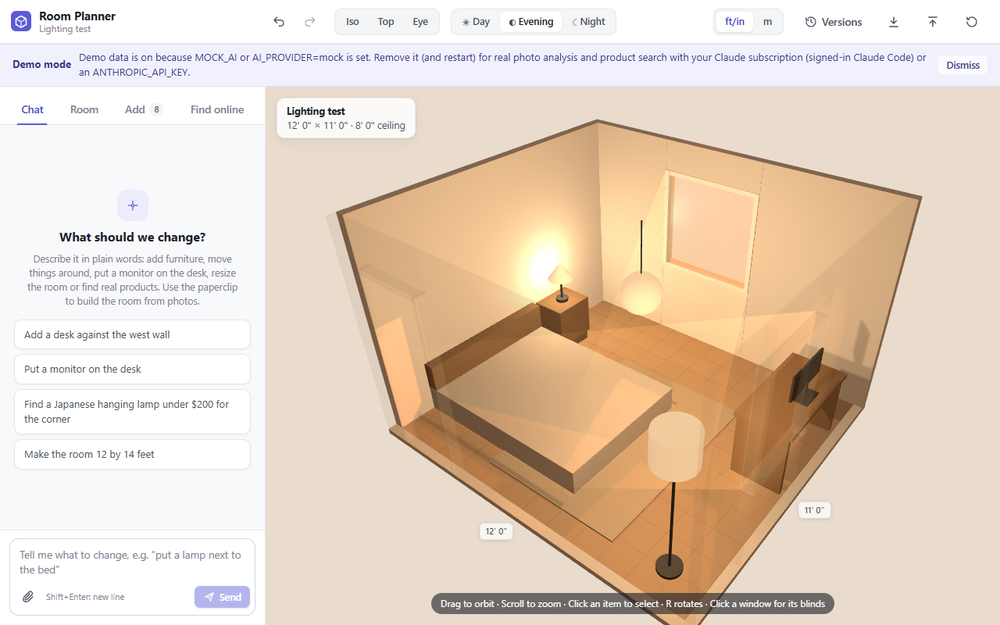
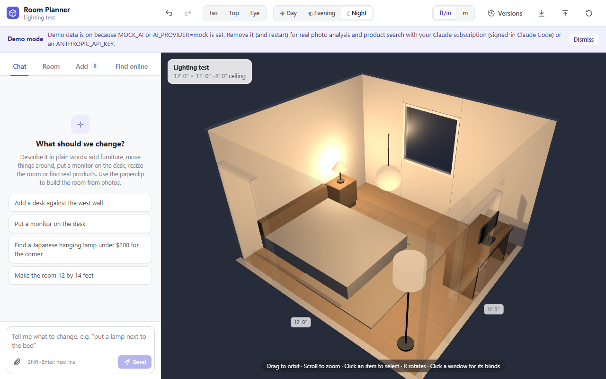
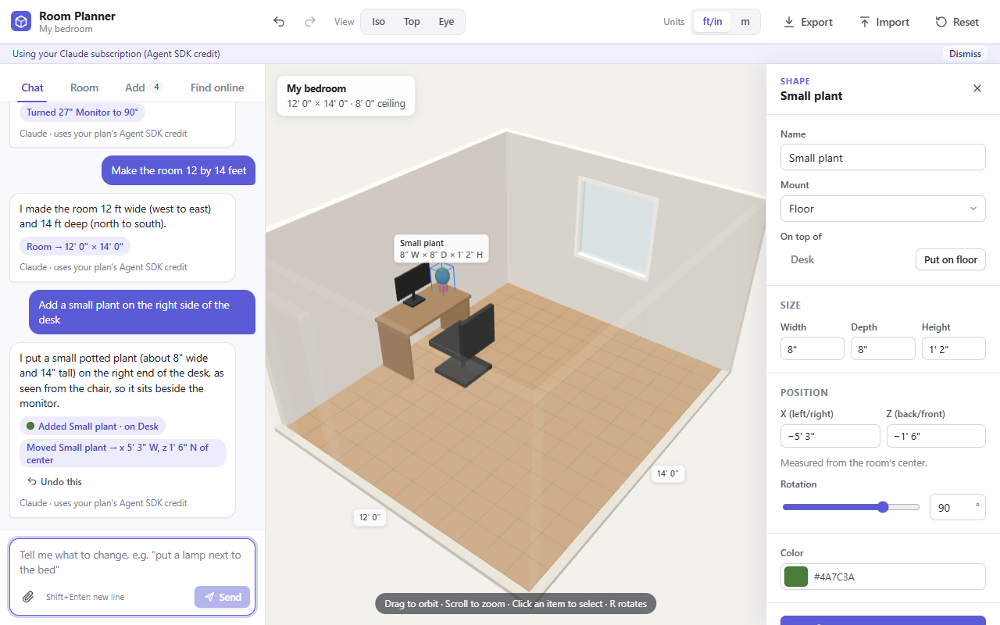
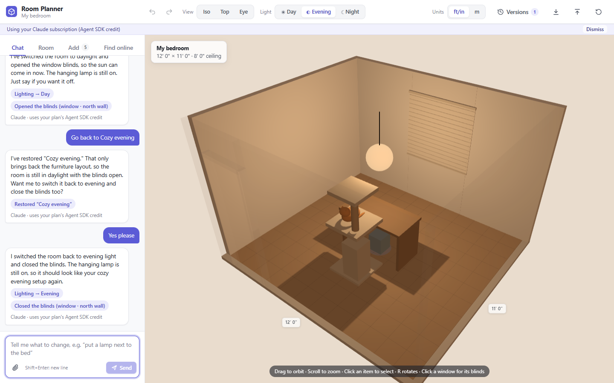

# Room Planner

Plan a room in 3D from a few photos, then furnish it with real products by chatting.

Upload one to three photos and Claude estimates the room's size, doors, windows and existing furniture as simple
editable shapes. Orbit around the room, arrange things, then describe what you want ("hanging lamp for the corner,
Japanese, under $200"): Claude searches the web for real products, and you can preview each one as a ghost in the
room before adding it at true scale.

**Stack:** React 19 · three.js (@react-three/fiber + drei) · zustand · TypeScript · Vite · Express 5 ·
Claude API / Claude Agent SDK · Vitest · Playwright



| Room from a photo | Product search results | Product placed |
|---|---|---|
|  |  |  |

## Contents

- [Features](#features)
- [Quick start](#quick-start)
- [Configuration](#configuration)
  - [Choosing a provider](#choosing-a-provider)
  - [Use your Claude subscription (no API key)](#use-your-claude-subscription-no-api-key)
  - [Demo mode](#demo-mode)
  - [Everyday use: a stable release that updates itself](#everyday-use-a-stable-release-that-updates-itself)
- [Using the app](#using-the-app)
  - [Chat](#chat)
  - [Building the room](#building-the-room)
  - [Adding and moving shapes](#adding-and-moving-shapes)
  - [Stacking and hanging](#stacking-and-hanging)
  - [Lighting](#lighting)
  - [Finding real products](#finding-real-products)
  - [Saving and versions](#saving-and-versions)
  - [Keyboard shortcuts](#keyboard-shortcuts)
- [Example sessions](#example-sessions)
- [How it works](#how-it-works)
- [Cost and latency](#cost-and-latency)
- [Development](#development)
  - [Scripts](#scripts)
  - [Project layout](#project-layout)
- [Known limitations](#known-limitations)

## Features

- **Room from photos.** One to three photos become an editable 3D room with doors, windows and furniture.
- **Chat to edit.** "Put a monitor on the desk", "make the room 12 by 14 feet", "turn off the pendant". Each reply
  is one undo step.
- **Real product search.** Claude searches the web, returns product cards with prices and sizes, and places your
  pick at true scale.
- **Stacking.** Items sit on, under or on a level of other items (a bin under a desk, a cat on a cat tower) and
  move with what supports them.
- **Lighting.** Day, Evening and Night modes, lamps that light the room, and window blinds.
- **Design versions.** Save, restore and compare named versions, with automatic snapshots before big changes.
- **Three ways to run Claude.** An Anthropic API key, your own Claude Pro/Max subscription (no key), or a demo
  mode that works end to end with no Claude at all.

## Quick start

Requires Node.js (a current LTS) and npm.

```bash
npm install
cp .env.example .env          # Windows PowerShell: Copy-Item .env.example .env
# either: set ANTHROPIC_API_KEY=sk-ant-... in .env
# or:     leave it empty and use your Claude subscription (see below)
npm run dev
```

Open **http://localhost:5173**. The API runs on http://localhost:8787; Vite proxies `/api` to it. The first line the
API prints says which backend it picked.

## Configuration

### Choosing a provider

`AI_PROVIDER` in `.env` picks the backend:

| `AI_PROVIDER` | Uses |
|---|---|
| `auto` (default) | `MOCK_AI=1` → demo data; else `ANTHROPIC_API_KEY` set → API; else your Claude subscription |
| `api` | Claude API with `ANTHROPIC_API_KEY` (the server refuses to start without one) |
| `subscription` | Your Claude Pro/Max plan via the Agent SDK (Claude Code login) |
| `mock` | Demo data |

### Use your Claude subscription (no API key)

If you have a Claude Pro or Max plan, the app can run photo analysis and product search on that plan through the
[Claude Agent SDK](https://www.npmjs.com/package/@anthropic-ai/claude-agent-sdk) instead of an API key.

Requirements:
- **Claude Code signed in on this machine** with your Pro/Max account. Run `claude` in a terminal once and sign in;
  the app uses that login. It never sees or stores your credentials.
- **Claim your plan's Agent SDK monthly credit** once, in your Claude account settings. Per Anthropic's support
  article [Use the Claude Agent SDK with your Claude plan](https://support.claude.com/en/articles/15036540-use-the-claude-agent-sdk-with-your-claude-plan),
  the credit covers Agent SDK usage in your own projects. When it runs out, requests stop unless you have turned on
  usage credits; the app then shows an error saying the credit or usage limit is used up.
- **No `ANTHROPIC_API_KEY`** in `.env` or your shell. With the default `AI_PROVIDER=auto`, a key always wins and the
  app uses the API instead. To use the subscription while a key is set, set `AI_PROVIDER=subscription`.

A slim **Using your Claude subscription (Agent SDK credit)** line shows at the top of the app in this mode
(dismissible). If the login is missing or expired, requests fail with a message telling you to run `claude` and
sign in.

<details>
<summary>How each subscription call is kept cheap and contained</summary>

- Every request starts the bundled Claude Code in an empty temp folder (`<os temp>/room-planner-agent`) with no
  settings files, no MCP servers (not even your claude.ai connectors), no saved session, the app's own system
  prompts instead of Claude Code's, and only the tools a step needs (none for photo analysis and structuring;
  `WebSearch` and `WebFetch` for product research).
- The Agent SDK's child process only gets an allowlist of OS variables (PATH, home and temp folders, proxy settings
  and `CLAUDE_CONFIG_DIR`). API keys, auth tokens, `ANTHROPIC_BASE_URL` and the variables of any Claude Code session
  you start the server from are never passed on, so the call always runs on your own login as an Agent SDK call.
- Each call has a dollar ceiling (room $1.50, research $3, structuring $1, chat $0.50). These are sanity caps, not
  expected costs.
- The API prints one line per call with the step, duration and the SDK's cost estimate, e.g.
  `[subscription] research: 74.2s, $0.4120, success`. Prompts, photos and credentials are never logged.

</details>

### Demo mode

Set `MOCK_AI=1` (or `AI_PROVIDER=mock`) and the API serves realistic mock data instead of calling Claude. A
**Demo mode** banner shows at the top of the app. The E2E tests run in this mode (the Playwright config forces it).

### Everyday use: a stable release that updates itself

`npm run dev` hot-reloads on every file save, which can break an open page while code is being edited. For
everyday use, run the published release instead:

```bash
npm run deploy:local   # typecheck + build into dist/, then publish it to release/ (with release/version.json)
npm start              # serves release/ on :5173 (vite preview, no hot reload) + the API on :8787
```

- Run `deploy:local` once before the first `npm start` (an empty `release/` has nothing to serve). `npm start` and
  `npm run dev` use the same ports, so run one at a time.
- `npm run build` only writes `dist/`, so work in progress never reaches the app you have open. Only
  `npm run deploy:local` publishes: it snapshots `dist/`, checks the snapshot is one complete build, copies it to
  `release/` and writes `version.json` last.
- The API under `npm start` runs the working-tree `server/` code and picks up server changes only when restarted.

<details>
<summary>How auto-update decides when to reload</summary>

Under `npm start` the page checks `/version.json` every 20 s (and when the tab regains focus). When
`npm run deploy:local` publishes a new build, the page reloads itself as soon as nothing would be lost:

- no chat reply, product search or room build running;
- no drag and no mouse button held (a slider);
- no message being typed in the chat box (a draft that sits there is saved and comes back, so it only waits while
  you type), and no other field being edited;
- no question open and no product preview showing.

Until then a slim bar says **App update ready** with **Update now**. The reload keeps the tab, the selection and the
camera view, and a short note says the app was updated. If a reload doesn't bring the new build (a release still
being copied), the page doesn't try again by itself; the bar stays with **Update now**. A request cut off by the
update says so, with a **Resend** button. The dev server (`npm run dev`) never reloads this way. A page opened
before auto-update existed needs one manual reload; after that it updates itself.

</details>

## Using the app

The sidebar has four tabs: **Chat** (opens by default), **Room**, **Add** and **Find online**. The toolbar switches
between three views: **Iso** (corner), **Top** (plan) and **Eye** (eye level from the door).

### Chat

The main way to work. Type what you want in plain words:

- "add a desk against the west wall", "put a monitor on the desk", "make the monitor black"
- "rotate it 90 degrees" (*it* = the item selected in 3D, or the item the last reply changed)
- "make the room 12 by 14 feet", "add a window on the east wall"
- "put the bin under the desk", "put the cat on the middle level of the cat tower"
- "hang the mirror on the wall", "hang the art at 5 ft", "hang the lamp from the ceiling", "lower the pendant by 6 inches"
- "hide the dresser" / "show the dresser", "put the monitor on the floor"
- "find a Japanese hanging lamp under $200", then "add the first one in the north-east corner"
- "swap the lamp for something mid-century", then "add the first one"
- "save this as option A", "go back to option A", "make it night", "movie night"

How replies work:

- Each reply lists what it changed as small chips: plain = done as asked; amber with a note = done, but differently
  ("shifted to avoid the bed"); grey = couldn't be done, with the reason.
- A whole reply is one undo step, and **Undo this** reverts just that reply (it asks first if later changes would be
  undone too). A turn's steps run in a sensible order (the desk moves before the monitor goes on it).
- The paperclip attaches 1–3 room photos and builds the room from them, asking first before it replaces added
  furniture.
- The conversation (last 50 messages) survives a reload. In demo mode a rule-based parser answers instead of Claude,
  and each reply says "demo parser".

<details>
<summary>Placement rules the chat follows</summary>

- New and moved items keep clear of other furniture and of doors and windows: a taken spot shifts to the nearest
  free one.
- Things put on a desk share it (screens go to the back when the desk stands against a wall). When the desk is full,
  a new item goes beside it on the floor and the chip says so.
- A chair put in front of a desk faces it; seating in a corner faces into the room.
- "On the left of the bed" means beside it, not on it. Left and right of a desk, table, dresser or shelf mean as seen
  by someone at it; beds, sofas and chairs use their own left and right.
- "Next to the bin" when the bin stands under a desk (or "next to the cat" on a cat tower) with no room right beside
  it puts the new thing on the floor beside the desk, as close to the bin as it fits.
- "Put the monitor on the floor" / "take it off the desk" lands it in front of the stack it was on. "Show the
  dresser" puts back what fell off it.
- After **Preview** on a product card, "add it next to the desk" adds the previewed product.

</details>

### Building the room

In the **Room** tab:

- Drop in 1–3 photos (or use the picker), then click **Build room from photos**. A real call takes a while; you can
  cancel it.
- **Tip:** fill in *one thing I know the size of* (e.g. ceiling height = `8'` or `2.44 m`). The model is told to use
  it, and the server rescales the whole room if the model's own estimate of that measurement differs. Leaving
  *What* blank means ceiling height.
- Everything stays editable: name, width, depth, height, wall and floor colors, and the list of doors and windows.
  You can also skip photos and type dimensions by hand. The app opens on a default 12' × 11' bedroom.

### Adding and moving shapes

- In the **Add** tab, click a preset (box, cylinder, sphere, cone, queen bed, desk, hanging lamp, floor lamp, table
  lamp, wall art, cat, cat tower) to add it. The three lamps come with a warm light.
- The item list groups everything as *Existing* (from photos), *Added* and *Products*. From the list you can select,
  hide or delete an item.
- Click an item to select it and open the inspector, then drag it. Floor and ceiling items move across the room;
  wall items slide along their wall and up or down. Drags snap to 1 in (or 1 cm in metric).
- The inspector covers size, position, rotation, color, mount (floor / wall / ceiling), snap to wall, move to
  corner, duplicate, lock and delete.

### Stacking and hanging

- **On top.** Drag a small floor item (a monitor, a lamp) onto a desk or table and it sits on top. Drag it off and
  it goes back to the floor. An item can't go on something much smaller than itself.
- **Under and on levels.** Things rest on the real surfaces of what they stand on, not on its bounding box. Point at
  the floor between a desk's legs and a bin goes **under** the desk; point at a cat tower's middle platform and the
  cat sits on that platform.
- **Live feedback.** While you drag, the item's label says where it will land ("↑ On Desk", "↓ Under Desk",
  "Cat tower — middle level", "On the floor") and that item lights up.
- **Moves together.** Moving or turning the desk carries what is on or under it. Deleting or hiding it drops those
  items to the floor, and showing it again puts them back.
- **Put on…** in the inspector lists the real surfaces an item fits on, never a lamp, a screen, a rug or something
  smaller than the item.
- **Hang from ceiling.** Any item can hang: a lamp gets a pendant's cord, other things hang flush. A hanging item
  has a **Drop** field (ceiling to its bottom) that lengthens or shortens its cord.

<details>
<summary>Edge cases</summary>

- In the Eye view an item at eye level follows the surface under the pointer too; pointing at the floor in front of
  a desk or cat tower puts it on the floor there.
- Hanging (ceiling) items never become floor items: they drag along the ceiling, and "on the desk" hangs them above
  it.
- A floor item named like a hanging lamp (an older pendant saved as a floor item) shows a hint pointing at
  **Hang from ceiling**.
- The **Drop** range runs from the item's own height to 1 ft off the floor; a value outside that is clamped, and
  the field shows what was used.
- Things under a desk or on a cat tower's level stay put only while they still fit. Lower the desk onto the bin, or
  swap the placeholder for a product that is one solid block, and the bin moves out in front of it (a cat goes to
  the product's nearest level).

</details>

### Lighting

| Day | Evening | Night |
|---|---|---|
|  |  |  |

- The toolbar's **Light** switch sets the time of day: **Day** (sunlight through open windows), **Evening** (warm low
  sun, lamps clearly count) or **Night** (only the lamps light the room). The mode never switches lamps on or off.
- Anything whose name says lamp, light, lantern, pendant, sconce or chandelier gets a warm light automatically; any
  other item gets one with **Make it a light source**. The inspector's **Light** section sets on/off, brightness and
  cool-to-warm color.
- Click a window in the 3D view (or use **Blinds** in the Room tab) to open or close its blinds.
- In chat: "make it night", "turn off the pendant", "make the lamp warmer", "dim the floor lamp", "close the
  blinds", and moods like "movie night" or "cozy evening".
- Lighting is how the room is viewed, not a design change: it doesn't count as an unsaved change, and restoring a
  version keeps the current lighting.

### Finding real products

In the **Find online** tab:

1. Describe what you want. You can also set mount, style and maximum price.
2. Results come back as cards: image, retailer, price, size (marked *est.* when estimated), colors, style, origin,
   materials, and a link to the product page.
3. **Preview** shows a translucent ghost in the room. The chip over the 3D view cycles through the results in the
   same spot.
4. **Add to room** places the product at true scale.

To swap out a placeholder you already placed, select it and click **Find real products for this** (**Find
alternatives for this spot** on a product). Previews then appear in its spot, and **Use here** replaces it.

### Saving and versions

- **Saving.** The plan saves automatically in the browser's localStorage and survives a reload. **Export** downloads
  `room-plan.json` and **Import** loads one back. **Reset** goes back to the default room (undoable).
- **Versions.** The toolbar's **Versions** button opens a drawer of saved designs, each with a thumbnail of the 3D
  view, its age and item count. **Save current** keeps the design under a name; **Restore** loads one (the design
  you had is kept first, and Ctrl+Z undoes the restore). Versions can be renamed, duplicated and deleted.
- **Auto versions.** The app also saves a version before big changes (a room built from photos, a chat reply with 3
  or more changes, Reset, Import, a restore) and at most one every 10 minutes while you edit. The newest 30 auto
  versions are kept; named ones stay until you delete them.
- **In chat:** "save this as option A", "go back to option A", "restore the previous version", "go back to how it
  was this morning". Save and restore happen exactly where they are written in a message ("put the monitor on the
  desk, save as A, then move the desk").
- **Export all versions** downloads the current design plus every version as one file, which Import accepts too.
  Several tabs share the versions. When localStorage runs short, the oldest auto versions are dropped first.

### Keyboard shortcuts

| Key | Action |
|---|---|
| Click / Esc | Select / deselect (Esc also clears a preview) |
| Arrow keys | Nudge 1 in / 1 cm, relative to the camera (Shift = 10×) |
| R / Shift+R | Rotate +15° / −15° (wall items always face out) |
| Ctrl+D | Duplicate |
| Delete / Backspace | Delete |
| Ctrl+Z | Undo |
| Ctrl+Shift+Z or Ctrl+Y | Redo |

Shortcuts are ignored while typing in a field.

## Example sessions

**A desk corner in four messages** (live, on a Claude subscription):

1. "Add a desk against the west wall and a chair in front of it": a 4 ft desk against the west wall and an office
   chair in front of it, turned to face the desk.
2. "Put a 27 inch monitor on the desk": a monitor about 0.6 m (24 in) wide, resting on the desk at the back, facing
   the chair.
3. "Make the room 12 by 14 feet": the room becomes 12' wide and 14' deep; the desk stays against the west wall.
4. "Add a small plant on the right side of the desk": a small potted plant on the desk's right end as seen from the
   chair.



**Stacking, lighting and versions** (live, 2026-10-03). It started from a Desk, a Cat tower, a Cat, a Hanging lamp
(switched off) and a small box named "Bin":

1. "Put the bin under the desk and the cat on the middle level of the cat tower": the bin went under the desk and the
   cat onto the tower's middle platform, about 3.1 ft up.
2. "Make it evening, close the blinds and turn on the hanging lamp": Evening mode, blinds closed, lamp on.
3. "Save this as Cozy evening": a named version.
4. "Make it day and open the window": Day mode, blinds open.
5. "Go back to Cozy evening": restored the version. A restore brings back the furniture, not the lighting, so the
   reply said the room was still in daylight and offered to switch it back.
6. "Yes please": Evening mode and blinds closed again.



More screenshots in [`docs/screenshots/`](docs/screenshots/): [room overview](docs/screenshots/overview.png), [top view](docs/screenshots/top-view.png),
[eye-level view](docs/screenshots/eye-view.png), [corner preview](docs/screenshots/corner-preview.png),
[compare in place](docs/screenshots/compare-in-place.png).

## How it works

```
Browser (Vite + React 19 + three.js via @react-three/fiber/drei, zustand store)
   │  /api/*  (Vite dev proxy)
   ▼
Express 5 API (tsx) ── AiProvider ──┬── api: Claude API via @anthropic-ai/sdk (ANTHROPIC_API_KEY)
                                    ├── subscription: Claude via @anthropic-ai/claude-agent-sdk (Claude Code login)
                                    └── mock: fixtures in server/fixtures/
```

- **Client.** `src/state/store.ts` holds all plan state: room, items, undo/redo history, persistence. The 3D scene
  (`src/scene/`) and the panels (`src/ui/`) read and write only through it. All lengths are stored in meters and
  shown in ft/in or meters. Photos are downscaled in the browser to at most 1568 px (long edge, JPEG) before upload.
- **Room from photos.** One structured-output call to `claude-opus-5-5` with the images and a zod schema. The server
  then rescales to the known measurement and checks the result: dimensions clamped to sane ranges, ids unique,
  colors valid, openings inside their walls.
- **Product search, in two steps.** (1) A research call with Claude's server-side web search tool writes a text
  report with URLs and facts. The server resumes the call when it pauses mid-search. (2) A separate structured-output
  call turns that report into product candidates, each with a primitive-shape approximation. The server then fetches
  each product page, drops dead links and fills in missing images from the page's preview-image tags.
- **Subscription mode.** The same two operations through the Claude Agent SDK: photo analysis is one call with the
  images and a JSON-schema output format; product search is a research call with Claude Code's `WebSearch` and
  `WebFetch` tools, then a separate structuring call. Only search hits and the URLs of pages that were fetched
  successfully (taken from the tools' structured output, never from links a model wrote in its text) feed the same
  checks, and both live modes share the post-processing in `server/postprocess.ts`.
- **Chat.** `POST /api/chat` sends the message, the last few turns and a compact scene (room, items with ids, the
  selection, the last search results and which result is being previewed). One structured-output call (effort low,
  the fixed system prompt cached) answers with a short reply and a list of actions. The server drops or clamps
  anything invalid and never lets the reply claim a step it dropped; the browser (`src/ui/chat/executeActions.ts`)
  turns placements like "on the desk" or "north-east corner" into free spots and applies the whole reply as one undo
  step.
- **Mock mode.** `server/mock.ts` returns fixture rooms and a fixture catalog after a short delay, with the same
  response shapes, so the UI can't tell the difference except for the banner.

## Cost and latency

Product searches use web search plus Claude Opus 5.5 (a research call followed by a structuring call);
room-from-photos is a single vision call; each chat message is one short structured call (effort low, no tools).

Observed on the subscription (Agent SDK) path, 2026-10-03, one run each (costs are the SDK's `total_cost_usd`
estimates, not a bill):

| Operation | Time | Cost |
|---|---|---|
| Room from one photo | 18.0 s | ~$0.04 |
| Product search (Japanese hanging lamp, ceiling, max $200; 5 products) | 2 min 20 s | ~$0.83 |
| Chat message | ~5–17 s | ~$0.02–$0.06 (first call after a prompt change up to $0.14) |

The API-key path has not been measured; expect a similar order of magnitude and check your Anthropic console after
a few real runs.

<details>
<summary>Per-message chat timings</summary>

Time from pressing Enter to the reply in the browser, then the server's cost line.

Desk corner session (plus one retry of the fourth message after a prompt fix):

| Message | In the browser | Server log |
|---|---|---|
| Add a desk against the west wall and a chair in front of it | 9.3 s | 8.9 s, $0.0216 |
| Put a 27 inch monitor on the desk | 10.8 s | 10.7 s, $0.0237 |
| Make the room 12 by 14 feet | 5.4 s | 5.2 s, $0.0166 |
| Add a small plant on the right side of the desk | 10.7 s | 10.5 s, $0.0250 |
| Same message again, after the prompt change | 16.9 s | 15.4 s, $0.0606 |

Stacking / lighting / versions session (about $0.25 in total):

| Message | In the browser | Server log |
|---|---|---|
| Put the bin under the desk and the cat on the middle level of the cat tower | 14.9 s | 14.1 s, $0.1398 |
| Make it evening, close the blinds and turn on the hanging lamp | 8.8 s | 8.0 s, $0.0211 |
| Save this as Cozy evening | 8.7 s | 7.4 s, $0.0209 |
| Make it day and open the window | 7.1 s | 6.6 s, $0.0225 |
| Go back to Cozy evening | 6.5 s | 5.3 s, $0.0229 |
| Yes please | 6.9 s | 6.0 s, $0.0235 |

The product search split into research (86.3 s, ~$0.58, 6 web searches) and structuring (53.2 s, ~$0.25). The
higher-cost first chat call in each session likely includes writing the prompt cache (not verified).

</details>

## Development

### Scripts

| Script | What it does |
|---|---|
| `npm run dev` | API (tsx watch, :8787) and web (Vite, :5173) together |
| `npm run dev:api` / `npm run dev:web` | Run either half alone |
| `npm start` | Serves the last published release (`release/`) with `vite preview` on :5173, plus the API on :8787 (no watch) |
| `npm run deploy:local` | Build, then publish `dist/` to `release/` (open `npm start` pages update themselves) |
| `npm run typecheck` | `tsc --noEmit` (TypeScript 7) |
| `npm test` | Vitest unit tests (`src/**`, `server/**`) |
| `npm run build` | Typecheck + Vite build into `dist/` |
| `npm run e2e` | Playwright tests; starts its own mock-mode API and web server (ports 5173 and 8787 must be free) |

### Project layout

```
server/            Express API
  app.ts           routes, zod request validation, error mapping
  provider.ts      provider selection (AI_PROVIDER / ANTHROPIC_API_KEY / MOCK_AI)
  claude.ts        API-key provider (vision call, web-search research, structuring)
  subscription.ts  subscription provider (same steps through the Claude Agent SDK)
  postprocess.ts   post-processing shared by both live providers
  mock.ts          demo provider; fixtures/ holds mock room + catalog
  mockChat.ts      demo-mode chat: rule-based command parser
  sanitizeChat.ts  checks and clamps chat actions from any provider
  prompts.ts, schemas.ts, convert.ts, sanitize.ts, verify.ts
src/
  shared/types.ts  API + data contract shared by client and server
  state/           zustand store (undo/redo, persistence), design versions (versions.ts), import validation
  lib/             geometry, units parsing/formatting, presets
  scene/           R3F scene: room mesh, items, drag, camera rig, shortcuts
  ui/              sidebar tabs, inspector, toolbar, versions drawer, lighting control, auto-update, API client
    chat/          chat panel, chat store, action executor
scripts/           dev.mjs (npm run dev / npm start), deploy-local.mjs (npm run deploy:local)
release/           the published build that npm start serves (written only by deploy:local)
e2e/               Playwright specs (mock mode) + fixtures
docs/screenshots/  screenshots used above
SPEC.md            original build spec
```

## Known limitations

- **Live mode is not covered by the automated tests.** Unit and E2E tests use mocks, stubbed fetch or a fake Agent
  SDK `query()` (the test setup blocks real Agent SDK calls). The subscription path was checked by hand through the
  UI on 2026-10-03. The API-key path has not been checked against a real key.
- **Subscription mode** depends on Claude Code's login and your plan's Agent SDK credit. Its `WebSearch` tool has no
  location setting, so the US-retailer preference comes from the prompt only.
- **Room shape.** Estimates from photos are rough. The room is a rectangular box with flat-colored primitives, no
  textures, no sloped ceilings and no L-shaped rooms. Give it a known measurement and expect to adjust things.
- **Products.** Sizes are often *estimated* (marked *est.*). Prices, stock and links change, and images are loaded
  from retailer sites and may not show up. Searches are tuned to US retailers and USD prices.
- **One user, one plan.** State lives in this browser's localStorage. Use Export/Import to move or back up a plan.
- **Bundle size.** The production JS bundle is about 1.26 MB (about 350 kB gzipped); Vite warns about chunk size.
  Harmless locally.
- **Rendering tests.** Headless E2E uses software WebGL (SwiftShader), so the tests don't cover rendering on a real
  GPU.
- **Lighting is an approximation**, not a light simulation: at Evening and Night only the two brightest lamps cast
  shadows, light passes through lamp shades, there is no bounce light, and up to four windows get a sun beam (always
  from the same angle). With 8 lamps and 3 windows the view held 60 fps on an integrated Intel Arc GPU (one headless
  run, 2026-10-03).
